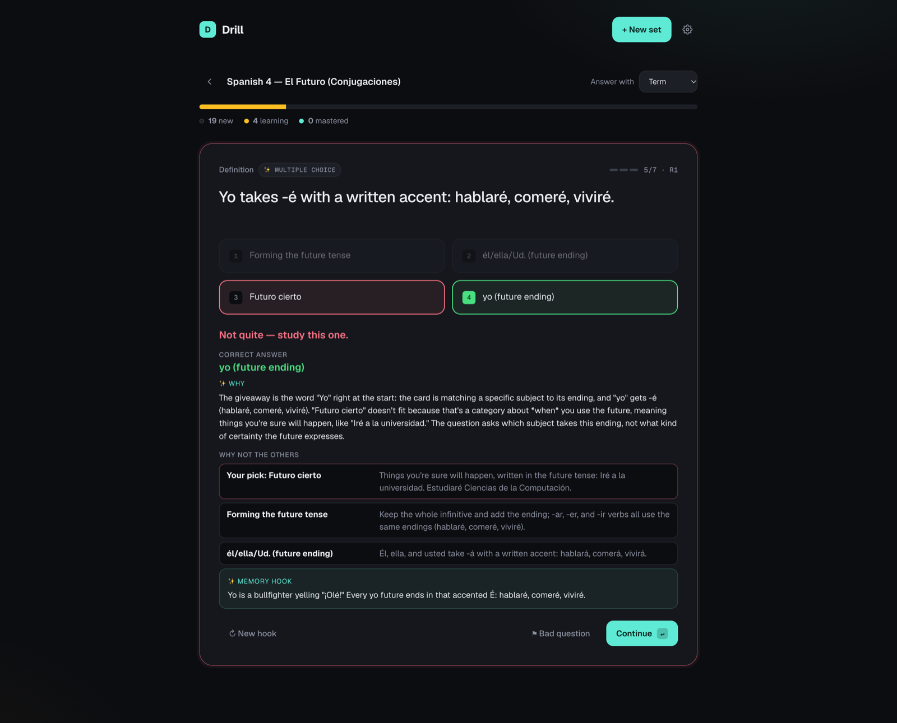

# Drill

A flashcard app for Mac with a "learn" mode that climbs each card from multiple choice to written recall, plus optional AI that grades answers by meaning, explains mistakes, writes memory hooks and turns your notes into sets.

Works fully offline without AI. Your sets stay on your Mac.



## Install

Needs macOS 13.3 (Ventura) or later, on Apple Silicon or Intel.

### Easiest: one line in Terminal (no security pop-ups)

1. Open **Terminal** (press ⌘ Space, type `Terminal`, press Return).
2. Paste this line and press Return:

```bash
curl -fsSL https://raw.githubusercontent.com/rishaank/drill/main/install.sh | bash
```

Drill installs into Applications and opens. Run the same line again any time to update; your sets are kept.

### Or: download the app

1. Download **Drill.dmg** from the [latest release](https://github.com/rishaank/drill/releases/latest).
2. Open it and drag **Drill** into **Applications**.
3. Double-click Drill. macOS says it "could not verify" Drill, because I don't pay Apple $99 a year to sign it. Click **Done**.
4. Open **System Settings → Privacy & Security**, scroll down, click **Open Anyway** next to Drill, and enter your Mac password.

You only do steps 3–4 once.

## AI (optional)

Turn it on in the welcome screen or in **Drill → Settings…** (⌘,), then pick a provider:

| Provider | Tag | What you need |
|---|---|---|
| Claude Code | Your Claude plan | The [Claude Code](https://claude.com/claude-code) app, logged in. Counts toward your plan's limits. |
| Google Gemini | Free Online | A free key from [Google AI Studio](https://aistudio.google.com/apikey) |
| Groq | Free Online | A free key from [Groq](https://console.groq.com/keys) |
| OpenRouter | Free Online | A free key from [OpenRouter](https://openrouter.ai/keys) (models ending in `:free`) |
| Ollama | Free Local | [Ollama](https://ollama.com/download) plus a model, e.g. `ollama pull gemma3` |
| LM Studio | Free Local | [LM Studio](https://lmstudio.ai) with its local server running |
| Anthropic API | Paid · API key | An Anthropic API key |
| OpenAI | Paid · API key | An OpenAI API key |
| Other | Any provider | Any OpenAI-compatible server: its URL, key and model |

API keys are saved only on your Mac (`~/Library/Application Support/Drill/keys.json`, readable only by your user) and are sent only to the provider you picked. Free online tiers have rate limits, and some providers may use free-tier prompts to train their models.

## Moving your sets

**File → Export All Sets…** (⇧⌘E) saves every set, with your progress, to one file. **File → Import Sets…** (⌘O) loads it on another Mac. Import also accepts single Drill set files.

If you use Claude, [`drill-set.skill`](drill-set.skill) is a Claude skill that turns notes, PDFs or word lists into a ready-to-study Drill set file you can paste into **File → New Set** (⌘N).

## Build it yourself

```bash
xcode-select --install
./build.sh
```

`build.sh` compiles `Drill.swift` (the window plus the AI bridge) around `index.html` (the whole app) and writes `dist/Drill.dmg` and `dist/Drill.zip`. `./test.sh` builds it and runs the app's self-checks in a throwaway copy that can't touch your sets. To publish a release with GitHub's `gh` tool: `gh release create v1.0.0 dist/Drill.dmg dist/Drill.zip`.
